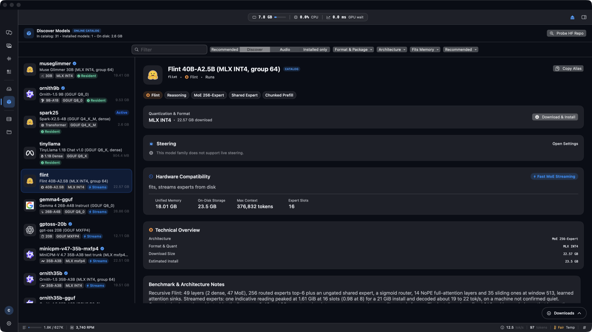
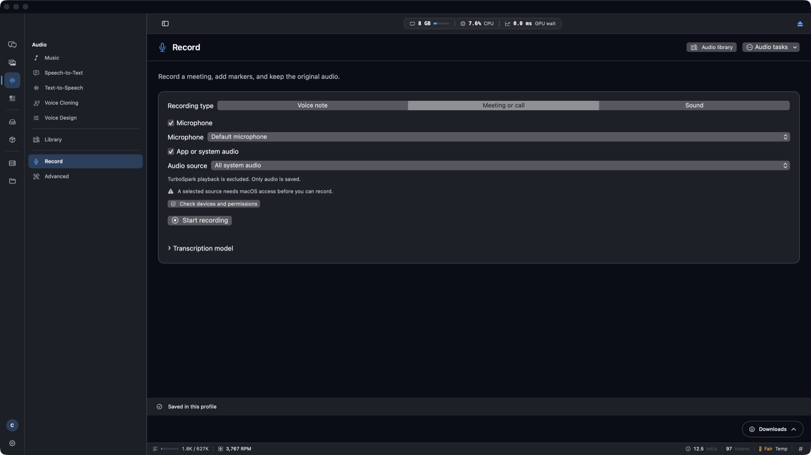
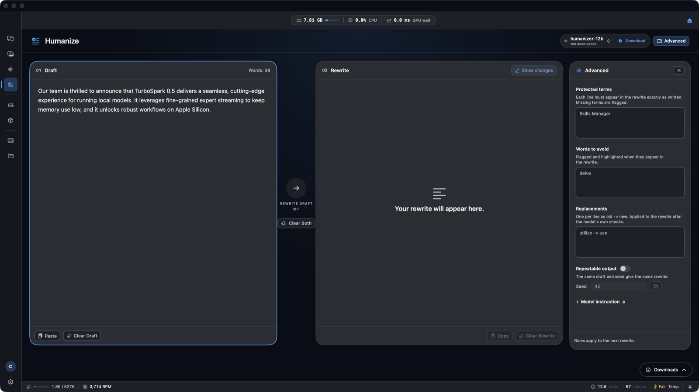
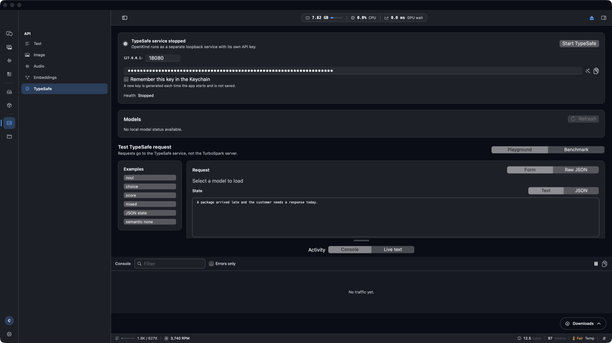
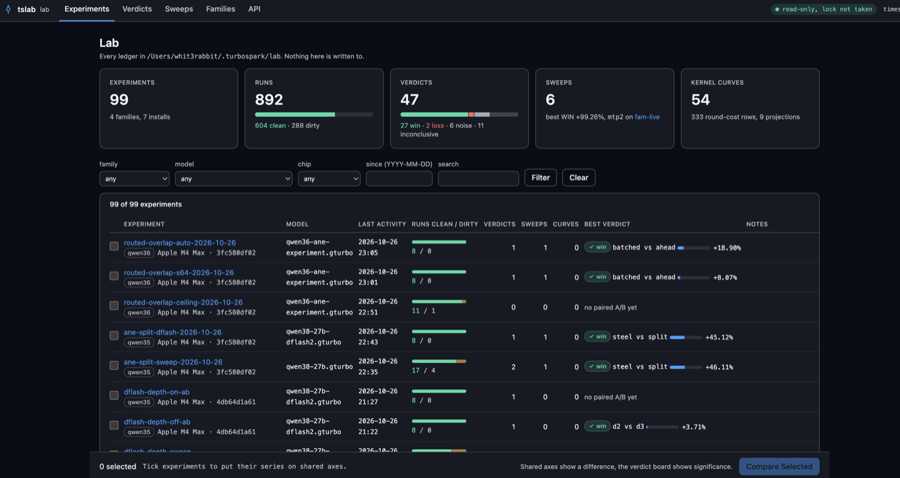

<p align="center">
  <picture>
    <source media="(prefers-color-scheme: dark)" srcset="assets/banner-dark.png" />
    
  </picture>
</p>

<p align="center">
  <b>Local language, image, audio, and music models on Apple Silicon.</b><br />
  Large Mixture-of-Experts models stream their experts from SSD and run in a small, bounded memory footprint.
</p>

<p align="center">
  <a href="https://github.com/whit3rabbit/turbospark/actions/workflows/ci.yml"></a>
  <a href="https://github.com/whit3rabbit/turbospark/actions/workflows/release.yml"></a>
  <a href="https://crates.io/crates/turbospark-cli"></a>
  <a href="LICENSE"></a>
  <a href="docs/RELEASE.md"></a>
</p>

<p align="center">
  <a href="https://turbospark.gitbook.io/turbospark/documentation">Documentation</a> | <a href="#install">Install</a> | <a href="#quickstart">Quickstart</a> | <a href="#supported-models">Supported Models</a> | <a href="#memory-and-benchmark-results">Benchmarks</a> | <a href="#image-generation">Image Generation</a> | <a href="#humanize">Humanize</a> | <a href="#audio">Audio</a> | <a href="#music-generation">Music</a> | <a href="#decision-models">Decision Models</a> | <a href="#supported-features">Features</a> | <a href="#turbospark-lab">Lab</a> | <a href="#more-details">More Details</a> | <a href="#license">License</a>
</p>

https://github.com/user-attachments/assets/a39f7cbc-f08f-41c3-a06c-4ec5a936b16f

<table align="center">
  <tr>
    <td align="center" valign="top" width="25%">
      <a href="assets/screenshots/models.png"></a><br />
      <sub><b>Model catalog</b><br />Memory fit for this Mac</sub>
    </td>
    <td align="center" valign="top" width="25%">
      <a href="assets/screenshots/audio.png"></a><br />
      <sub><b>Audio</b><br />Record, transcribe, speak</sub>
    </td>
    <td align="center" valign="top" width="25%">
      <a href="assets/screenshots/humanize.png"></a><br />
      <sub><b>Humanize</b><br />Your rules, applied after</sub>
    </td>
    <td align="center" valign="top" width="25%">
      <a href="assets/screenshots/api.png"></a><br />
      <sub><b>API workspace</b><br />Typed local decisions</sub>
    </td>
  </tr>
</table>

> **Early work in progress.** Expect bugs and breaking changes.

TurboSpark is a native macOS app and Rust workspace for running local language models on Apple Silicon. Its main advantage is fine-grained Mixture-of-Experts (MoE) streaming: routed expert weights stay on SSD until they are needed, so supported large MoE models can run with a small bounded memory footprint.

I built it as a hobby/side project as an alternative to LM Studio but there are other projects like Unsloth Desktop which are a lot more refined.

The app provides desktop chat and agent tools. The Rust crates provide the Metal inference engine, model installer, command-line tools, HTTP server, and Swift/C bindings. Complete user guides and API documentation are available at [turbospark.gitbook.io/turbospark/documentation](https://turbospark.gitbook.io/turbospark/documentation).

Beyond chat, everything below runs on your Mac with no cloud service:

- **[Humanize](#humanize).** Rewrite a draft with a local 12B model, then check the result against your own rules and an automatic audit.
- **[Audio](#audio) and [Music](#music-generation).** Speech to text, text to speech, voice activity detection, zero-shot voice cloning, and fast 8-step music generation, with native Metal and FluidAudio Core ML / Apple Neural Engine acceleration.
- **[Decision models](#decision-models).** Typed yes/no, choice, and score answers from small local models through the bundled OpenKind daemon.
- **[Image generation](#image-generation).** Z-Image Turbo and Qwen-Image 2.1 Turbo through Swift and MLX.
- **Local API.** OpenAI- and Anthropic-compatible chat endpoints, plus image and audio routes, from the app or `turbospark-server`.

## Install

TurboSpark targets Apple Silicon. The desktop app and Homebrew casks require macOS 14 Sonoma or newer.

### Homebrew, recommended

Install the app and CLI tools:

```sh
brew install --cask whit3rabbit/tap/turbospark
```

This installs `TurboSpark.app` in `/Applications` and puts these commands on your `PATH`:

```text
turbospark          front end: run, humanize, image, serve, and model commands
turbospark-check    generate text
turbospark-model    find and install models
turbospark-server   run the local API server
```

The release app is ad-hoc signed and not notarized, and Homebrew no longer has a `--no-quarantine` option, so macOS blocks the first launch ("Apple could not verify..."). Clear the quarantine attribute once after installing:

```sh
xattr -dr com.apple.quarantine /Applications/TurboSpark.app
```

Or open **System Settings > Privacy & Security**, scroll to the message about TurboSpark, and click **Open Anyway**. Control-click then **Open** no longer works on current macOS.

The media tools `turbospark-image`, `turbospark-music`, and `turbospark-clone` are not in the casks. Install them with the [Rust CLI](#rust-cli).

For CLI tools only:

```sh
brew install --cask whit3rabbit/tap/turbospark-cli
```

The two casks conflict. Choose the app cask or the CLI-only cask.

### Rust CLI

Install the published CLI and server crates with Rust stable:

```sh
cargo install turbospark-cli turbospark-server
```

`turbospark-cli` builds all six CLI commands, including `turbospark-image`, `turbospark-music`, and `turbospark-clone`.

To build the whole workspace from source, install Xcode Command Line Tools and run:

```sh
git clone https://github.com/whit3rabbit/turbospark.git
cd turbospark
cargo build --workspace --release
```

The source build produces the user-facing binaries under `target/release/`. See [`docs/DEVELOPMENT.md`](docs/DEVELOPMENT.md) for the full build and test setup.

### Manual DMG

Every [GitHub Release](https://github.com/whit3rabbit/turbospark/releases) includes an Apple Silicon DMG named `TurboSpark-<version>-arm64.dmg`.

1. Download the DMG from the release assets.
2. Open it and drag `TurboSpark.app` to `/Applications`.
3. If macOS blocks the first launch, clear the quarantine attribute (or use **Open Anyway** in System Settings > Privacy & Security):

   ```sh
   xattr -dr com.apple.quarantine /Applications/TurboSpark.app
   ```

The release app is ad-hoc signed and not notarized, so this step is expected for a manual download.

The app bundle contains the CLI binaries. The Homebrew app cask also links them onto `PATH`.

## Quickstart

Install a catalog model, then start an interactive chat:

```sh
turbospark-model pull gemma4
turbospark-check --model gemma4 --chat
```

To use another model, inspect what fits this Mac first:

```sh
turbospark-model list
turbospark-model recommend
turbospark-model pull qwen36
```

Run the local OpenAI- and Anthropic-compatible server:

```sh
turbospark-server --model gemma4
```

The default server listens on `127.0.0.1:8080` and provides `/v1/chat/completions`, `/v1/messages`, `/v1/models`, and `/health`. See [`docs/CLI.md`](docs/CLI.md) for server flags and client setup.

The `turbospark` front end (reworked in 0.6.0, shipped with all its peer binaries since 0.6.5) takes ollama-style tags (`qwen3.6:35b`) and verbs, and the server also answers on an Ollama-compatible `/api`:

```sh
turbospark                        # what is installed, what fits, what to type
turbospark run qwen3.6            # chat, downloading the model first if needed
turbospark ls                     # installed models
turbospark doctor                 # this machine, and which models fit
turbospark serve --model qwen3.6  # OpenAI, Anthropic and Ollama APIs
turbospark launch claude --model qwen3.6   # start a coding agent against the local server
```

`launch` also starts `codex`, `opencode`, `grok`, `gemini`, `hermes`, `openclaw`, and `dsh`. The full command list is in [`docs/CLI.md`](docs/CLI.md).

## Supported models

TurboSpark supports 17 declared model families (DeepSeek-V4-Flash is still scaffolded-only). The newest two are LFM3-1.7B, a small dense hybrid of gated short-convolution and attention layers, and Flint 40B-A2.5B, an MoE with 256 routed experts per layer that streams from SSD like the others. Recent additions also include the Bonsai line (1-bit Bonsai, 2-bit Ternary-Bonsai, and the Hadamard-folded Ternary-Bonsai 2), Qwen3.8-27B dense with MTP/DFlash2 speculative decoding and an optional vision tower, Qwen3.8-Flash-Next REAP-288 and the text-only Swift-1.5 IQ2_XS GGUF, Qwen3-VL 4B with image input, MiniCPM-V 4.7 35B-A3B (text only, MLX mxfp4), DeepSeek-V2-Lite (MLA), Spark-X2.5, Muse Glimmer, Qwen2.5, and gpt-oss. MiniMax-M2 is implemented but not yet catalog-promoted.

MoE checkpoints can stream routed experts from SSD through a bounded cache,
so install size and process footprint are different quantities. The Swift
IQ2_XS source payload is 68.15 GB. Its measured process peak is about 1.60
GiB at 2K context and 16 slots on an M4 Max.

The catalog in [`crates/catalog/src/models.json`](crates/catalog/src/models.json) is the source of truth. Use `turbospark-model list` for current aliases and evidence status, and `turbospark-model recommend` to rank these for your machine.

### MoE checkpoints (experts stream from disk)

The process peak is measured `phys_footprint` on a 36 GB M4 Max with 16 expert-cache slots, at the listed context. It is not the total working set or a minimum system-RAM requirement. Mapped model weights are not fully represented by this counter. A dash means no frozen process-footprint row is published for that install yet. `turbospark-model info <alias>` carries its evidence status.

| Model | Quant | Format | Disk | Measured process peak |
| --- | --- | --- | ---: | ---: |
| Qwen 3.6 35B-A3B | INT4 (group 64) | MLX | ~18 GB | ~1.6 GB @ 4k ctx |
| Qwen 3.6 35B-A3B | Q4_K_M | GGUF | ~21 GB | - |
| Ornith-1.5 35B-A3B | INT4 (group 64) | MLX | ~20 GB | - |
| Ornith-1.5 35B-A3B | Q8_0 | GGUF | ~38 GB | - |
| MiniCPM-V 4.7 35B-A3B, text only (`minicpm-v47-35b-mxfp4`) | mxfp4 (group 32) | MLX | ~22 GB | ~1.5 GB @ 4k ctx |
| Flint 40B-A2.5B (`flint`) | INT4 core, 3-bit routed experts | MLX | ~18.6 GB | - |
| Flint 40B-A2.5B, trained build (`flint-int4`) | INT4 (group 64) | MLX | ~23.5 GB | - |
| Qwen3.8-Flash-Next REAP-288 | INT4 | MLX | ~74 GB | ~2.5 GB @ 2k ctx |
| Qwen3.8-Flash-Next Swift-1.5 (`qwen4exp-swift-iq2-xs`) | IQ2_XS | GGUF | ~69 GB reserve | ~1.60 GiB @ 2k ctx |
| Qwen3-30B-A3B | Q4_K_M | GGUF | ~19 GB | ~2.7 GB @ 4k ctx |
| Gemma 4 26B-A4B | INT4 (group 64) | MLX | ~13 GB | ~2.1 GB @ 4k ctx |
| Gemma 4 26B-A4B | UD-Q3_K_M (IQ3 experts) | GGUF | ~13 GB | ~1.9 GB @ 4k ctx |
| Gemma 4 26B-A4B | Q8_0 | GGUF | ~27 GB | - |
| gpt-oss 20B | MXFP4 | GGUF | ~12 GB | ~5.4 GB @ 8k ctx |
| DeepSeek-V2-Lite 16B (MLA) | Q8_0 | GGUF | ~17 GB | ~4.1 GB @ 8k ctx |
| Mixtral 8x7B | Q4_K_M | GGUF | ~29 GB | - |

Flint has no frozen row either. The default `flint` build cuts only the routed experts to 3-bit, which shrinks the download from 22.6 GB to 17.8 GB. Against the trained INT4 build it measured a mean KL of 0.213 nats and 82.8 percent top-1 agreement, so it trades quality for size. One indicative reading of the default build peaked at 1.40 GiB at 16 slots, taken on a short prompt with a download running alongside, so treat it as a rough guide. The INT4 build read 1.61 GiB and about 19 to 22 tok/s the same way.

Flint reasons inside an inline `<think>` block and has no speculative decoding or tool-call parsing yet. Its prefill is sequential by default, about 36 tok/s on the INT4 build, so a 1,667-token prompt takes roughly 46 seconds. See [`docs/FLINT.md`](docs/FLINT.md).

Mixtral has no frozen process-footprint row. Its estimated slot-cache
capacity is about 55 GiB at 16 slots, so it does not fit ordinary machines.
Expert granularity drives slot-cache sizing, not model file size: Qwen3-30B-A3B
splits its experts smallest here but has 48 layers of them, while gpt-oss's 32
experts are individually huge. The measured peaks are observations for the
listed configurations, not guarantees for other machines or settings. See
the slot arithmetic in [`docs/MODEL_FAMILY.md`](docs/MODEL_FAMILY.md) and use
`turbospark-model recommend` for the active machine and context.

### Dense checkpoints (weights stay memory-mapped)

Dense models do not stream, so budget roughly the on-disk size plus KV and scratch that grow with context. The small "peak footprint" numbers in [`docs/BENCHMARKS.md`](docs/BENCHMARKS.md) for these rows are a leak sentinel, not a capacity number: mapped weights do not appear in them.

| Model | Quant | Format | Disk | Notes |
| --- | --- | --- | ---: | --- |
| Qwen3.8 27B | INT4 (group 64) | MLX | ~15 GB | MTP and DFlash2 speculative decode, plus an optional vision tower (~16 GB combined, or a ~1 GB tower sidecar) |
| Bonsai 27B | 1-bit affine (group 128) | MLX | ~4 GB | the Qwen3.8 27B line at 1 bit |
| Ternary-Bonsai 27B | 2-bit affine (group 128) | MLX | ~8 GB | |
| Ternary-Bonsai 2 27B | 2-bit affine, Hadamard-folded | MLX | ~8 GB | newest of the line |
| Ornith-1.5 9B | Q8_0 | GGUF | ~10 GB | |
| Qwen2.5 7B Instruct | INT4 / Q3_K_M / Q4_K_M | MLX + GGUF | ~4-5 GB | |
| Qwen3-VL 4B Instruct | INT4 (group 64) | MLX | ~2.3 GB | text trunk, with image input via the combined deepstack install (~2.9 GB) |
| Muse Glimmer 30B | INT4 (group 64) | MLX | ~16 GB | |
| Humanizer 12B (dense Gemma 4, `humanizer-12b`) | INT8 (group 64) | MLX | ~12.7 GB | raw-completion rewriter behind [Humanize](#humanize), no chat template |
| Spark-X2.5 4B | Q4_K_M | GGUF | ~2.6 GB | |
| LFM3 1.7B (`lfm3-1.7b`, `lfm3-1.7b-q8`) | INT4 (group 64) / Q8_0 | MLX + GGUF | ~1.0 / 1.8 GB | dense hybrid of gated short-conv and attention layers; chunked prefill on the INT4 install only |
| Mistral 7B Instruct v0.3 | Q4_K_M | GGUF | ~4.4 GB | |
| TinyLlama 1.1B Chat | Q6_K | GGUF | ~0.9 GB | |

Vision intake is per-family: the Qwen GDN dense and MoE flows and the Qwen3-VL trunk carry the implemented tower today, and the other rows are text-only. See [`docs/VISION.md`](docs/VISION.md).

New checkpoints are not automatically supported just because their architecture name matches. The catalog probe checks the checkpoint header, tokenizer sidecars, tensor types, and memory shape before installation. Read [`docs/MODELS.md`](docs/MODELS.md) before adding a model outside the catalog.

## Memory and benchmark results

These rows are measured `phys_footprint` process peaks on one Apple M4 Max with 36 GB unified memory. They use the listed context window. MoE rows use 16 expert-cache slots. Process footprint is not the model's on-disk size or a minimum system-RAM requirement. Results vary by chip, context, cache size, and workload.

| Model | Context | Peak footprint | Decode | Install on disk |
| --- | ---: | ---: | ---: | ---: |
| Gemma 4 26B-A4B, MLX INT4 | 4,096 | 2,175 MiB | 33.0-45.6 tok/s | about 13.0 GB |
| Qwen 3.6 35B-A3B, MLX INT4 | 4,096 | 1,610 MiB | 32.6-38.0 tok/s | about 18.0 GB |
| MiniCPM-V 4.7 35B-A3B text trunk, MLX mxfp4 | 4,096 | 1,491 MiB | 24.0-25.6 tok/s | about 22.0 GB |
| Qwen3-30B-A3B, GGUF Q4_K_M | 4,096 | 2,748 MiB | 16.0-27.3 tok/s | about 18.6 GB |
| Swift-1.5 Qwen3.8-Flash-Next, GGUF IQ2_XS | 2,048 | 1,634 MiB | 12.23-12.77 tok/s | about 69 GB reserved |
| Qwen 3.8 27B, MLX INT4, dense | 4,096 | 661 MiB | 16.8-19.0 tok/s | about 15.2 GB |
| Qwen 3.8 27B + MTP head, MLX INT4, dense (greedy, MTP speculation) | 4,096 | 872 MiB | 21.9-28.7 tok/s | about 15.4 GB |
| gpt-oss 20B, GGUF MXFP4 | 8,192 | 5,422 MiB | 23.4-31.3 tok/s | about 12.2 GB |
| LFM3-1.7B, MLX INT4, dense hybrid | 8,192 | 342-351 MiB | 67.8-198.1 tok/s | about 0.97 GB |
| LFM3-1.7B, GGUF Q8_0, dense hybrid | 8,192 | 344-350 MiB | 84.1-94.7 tok/s | about 1.8 GB |
| Humanizer 12B, MLX INT8, dense (raw completion) | 8,192 | 774-924 MiB | 6.5-13.4 tok/s | about 12.7 GB |

The MTP row uses greedy decoding with MTP speculation (block 2), measured with other sessions running on the host. In the same capture, the same install read 14.7-17.9 tok/s without speculation.

LFM3's MLX decode reads either about 180 to 198 or about 68 to 71 tok/s from run to run, so its range is wide. The Q8_0 row matches llama.cpp token for token on the same bytes (greedy, 600 tokens on one prompt). See [`docs/LFM3_PHASE0.md`](docs/LFM3_PHASE0.md).

MiniCPM-V 4.7 runs the same trunk as Qwen 3.6 but ships its embedding, head, and GDN projections in BF16, so it reads more bytes per token and decodes slower. Its prefill is sequential: a 2,940-token prompt takes about 2 minutes before the first token. See [`docs/MINICPM.md`](docs/MINICPM.md).

Decode and prefill work since 0.5.0 is recorded in [`CHANGELOG.md`](CHANGELOG.md) and is not part of the frozen table above. All of it was measured on the same M4 Max:

- **DFlash2 tree verify** is on by default for greedy fixed-depth rounds. At block 7 it gained 9.2% decode tok/s on a medium-review prompt and 4.3% on a short explanation, and `TURBOSPARK_DFLASH_TREE=0` keeps the chain.
- **DFlash2 chunked prefill** is on by default. A 426-token prompt prefills at 130 to 158 tok/s, against 16 to 23 when it walked token by token.
- **Batched routed experts** are opt-in (`TURBOSPARK_ROUTED_BATCH=1`). On Qwen 3.6 at `auto` slots, a 2,940-token prompt prefills in 20.2 s instead of 33.3 s. At 16 slots the gain is about 2.5%.
- **LFM3 chunked prefill** is on by default for INT4 installs and prefills about 8.7x faster at 2,918 tokens, with a mean KL of 1.9e-5 nats against the per-token path (`TURBOSPARK_LFM3_CHUNKED_PREFILL=0` restores it). Its decode also takes the GQA-shared attention kernel by default, about 18.6% faster at that context. The Q8_0 install stays sequential.
- **GDN turn snapshot** is opt-in (`TURBOSPARK_GDN_TURN_SNAPSHOT=1`) for dense Qwen models. Multi-turn chats reuse a long document prefix without re-prefilling it.

The low-memory result is primarily an MoE result. Dense models run, but they do not get the same routed-expert streaming benefit. For the complete measured rows, quality gates, cross-engine comparisons, and methodology, see [`docs/BENCHMARKS.md`](docs/BENCHMARKS.md) and [`docs/BENCHMARKING.md`](docs/BENCHMARKING.md).

## Image generation

The app generates images on your Mac with two models. Choose one from the Model menu on the Images screen, or download it from the model manager. Both run through Swift and MLX, and the same models can be served from the local API at `POST /v1/images/generations`.

| Model | Alias | Steps | 1024 x 1024 on an M4 Max | Peak memory | License |
| --- | --- | --- | --- | --- | --- |
| Z-Image Turbo, 8-bit | `z-image-turbo-mlx-8bit` | 9 | about 1 to 1.5 minutes | 12.8 GiB | Apache-2.0 |
| Qwen-Image 2.1 Turbo, mixed 4-bit and 8-bit | `qwen-image-2.1-turbo-mlx-mixed-4bit` | 8 | about 1.5 minutes | 11.2 GiB | Qwen Research License, non-commercial |

Z-Image Turbo also has smaller 2-bit, 4-bit, and q4 exports for Macs with less memory. Qwen-Image 2.1 Turbo took 20 to 26 seconds for a 512 x 512 image.

These are measurements from one machine, not promises. Z-Image Turbo is a median of three runs (58 s in [`docs/BENCHMARKS.md`](docs/BENCHMARKS.md), 87 s in an earlier set). Qwen-Image 2.1 Turbo is a single run (96 s) and took 153 s once while the machine was busy. See [`docs/QWEN_IMAGE_21_TURBO.md`](docs/QWEN_IMAGE_21_TURBO.md) for the conditions.

Models on an external drive or in another folder show up if you add the folder under Settings > Models > Additional Model Folders. Removing one from the list leaves its files where they are.

The `turbospark-image` command uses the native Metal runtime, which supports only Z-Image Turbo and is far slower than the app: the recorded run took about an hour for one 1024 x 1024 image. Use the app for now.

## Humanize

Humanize rewrites a draft so it reads less like machine-generated text. It runs `humanizer-12b`, a dense Gemma 4 12B checkpoint (MLX INT8, about 12.7 GB on disk), with an 8,192-token window. Paste a draft, run it, and read the rewrite beside the original with new and dropped wording marked.

The model was trained on one fixed instruction, so the engine refuses prompt edits. Your rules run outside the model, on the finished rewrite:

- **Protected terms** must appear in the rewrite exactly as written.
- **Words to avoid** are highlighted wherever they appear.
- **Replacements** apply `old -> new` pairs to the result.
- **A fixed seed** gives the same rewrite for the same draft.

Every rewrite also gets an audit. It flags numbers the rewrite dropped or invented, a switch between Latin and CJK script, and a rewrite that copies too much of the draft word for word. The audit only warns. It never edits the text. The model's publisher reports that fact slips still happen, so proofread the result before you use it.

Long drafts are split into parts and rewritten one part at a time. The CLI runs the same rewrite and audit. The rules above are app-only.

```sh
turbospark-model pull humanizer-12b
turbospark humanize humanizer-12b draft.txt --seed 3
```

## Audio

TurboSpark transcribes speech, speaks text, detects voice activity, clones voices, and generates music on your Mac. The app's Audio workspace covers all five modalities, and `turbospark-server` serves most of them over HTTP.

The Audio workspace records the microphone, system audio (using native macOS 14.2+ CoreAudio process taps without screen-recording prompts), or both, with real-time live drafting, speaker diarization, cross-meeting speaker recognition, custom vocabulary jargon dictionaries, and structured meeting notes summaries. Recordings, transcripts, and generated takes are stored in your encrypted profile.

### FluidAudio integration

The desktop app integrates [FluidAudio](https://github.com/FluidInference/FluidAudio) Core ML pipelines, running speech and audio tasks on the Apple Neural Engine (ANE) and GPU for low power and high throughput:

- **Kokoro ANE**: High-speed text-to-speech with mixed Neural Engine and GPU placement.
- **PocketTTS**: GPU-accelerated English text-to-speech.
- **Parakeet TDT Japanese & Paraformer Mandarin**: Neural Engine-accelerated speech recognition.
- **Silero VAD**: Low-latency voice activity detection running on the CPU/ANE.
- **Privacy-first offline contract**: FluidAudio is isolated from remote Hugging Face endpoints at runtime (`ModelHub.offlineMode = true`), ensuring all model assets are verified and installed through TurboSpark's catalog without unvetted network access. See [`docs/FLUIDAUDIO.md`](docs/FLUIDAUDIO.md).

### Installable audio models

| Task | Catalog models | Runs in |
| --- | --- | --- |
| Speech to text | Whisper (tiny, base, and small, including MLX 8-bit and 4-bit builds), Qwen3-ASR 0.6B, Parakeet TDT Japanese (ANE), Paraformer Mandarin (ANE) | app, `turbospark-server` (Whisper, Qwen3) |
| Voice activity detection | Silero VAD Core ML | app |
| Text to speech | Kokoro 82M (Metal and ANE Core ML), PocketTTS (Core ML) | app, `turbospark-server` (Kokoro Metal) |
| Text to speech, voice design, and voice cloning | Qwen3-TTS 0.6B and 1.7B (CustomVoice, VoiceDesign, and Base) | app only, through Swift MLX |
| Voice cloning | MegaTTS3 | app, `turbospark-clone`, `turbospark-server` |
| Music | MiniMax Music 3 (4-bit, 6-bit, 8-bit, bf16, mxfp8), MiniMax Music 3 Turbo 8-step LoRA | app, `turbospark-music`, `turbospark-server` |

The app's audio model manager installs these. `crates/audio` also carries ports of more TTS, speech-to-text, speech-to-speech, and codec families that are not in the install catalog yet, including Bark, Dia, MeloTTS, Canary, and Granite Speech. [`crates/audio/MODELS.md`](crates/audio/MODELS.md) records what each one has been verified to do.

### Voice cloning with MegaTTS3

The `turbospark-clone` command and the app's Audio Studio clone a voice from a short reference recording and speak English text. The reference is a WAV file at any sample rate, mono or multichannel, and only its first 28 seconds are used.

```sh
turbospark-clone speak \
  --model megatts3-f32 \
  --reference reference.wav \
  --text "Hello, this is a cloned voice." \
  --quality balanced \
  --output output.wav \
  --consent
```

- **Quality presets**: `--quality fast` (8 steps), `--quality balanced` (16 steps, default), or `--quality best` (32 steps). You can also pass `--steps` directly (1 to 100).
- **Metal acceleration**: On macOS, the diffusion transformer and WavVAE decoder run on Metal by default. That measured about 5x faster than the CPU reference path on a short request, and it holds 1.4 to 2.9 GiB more memory. Pass `--cpu` to force the portable CPU path.
- **Consent required**: Voice cloning requires explicit caller consent (`--consent` in CLI, or user acknowledgment in the app) because the community WavVAE encoder's provenance and license are unverified.

### Audio over HTTP

`turbospark-server` takes one or more audio models at startup:

```sh
turbospark-server \
  --stt-model whisper-base-en \
  --tts-model ~/models/kokoro-82m \
  --music-model minimax-music3-turbo-4bit-8step \
  --api-key "$KEY"
```

It serves these routes:

- `POST /v1/audio/transcriptions`, plus a realtime WebSocket
- `POST /v1/audio/speech`
- `POST /v1/audio/generate` for music, with async jobs at `GET /v1/audio/jobs/ID`

Input audio is WAV only, and each model runs one request at a time. Served behavior of real models is smoke-tested, not benchmarked. See [`docs/AUDIO_API.md`](docs/AUDIO_API.md) for every route and limit.

## Music generation

`turbospark-music`, the desktop app's Music Studio, and `turbospark-server` generate full-fidelity music tracks using MiniMax Music 3, accelerated natively on Apple Silicon Metal.

### Metal performance and MLX parity

On macOS, all MiniMax Music 3 kernels (DiT transformer, condition encoder, flow matching Euler step, and vocoder) run on Metal. With `--flow-profile exact`, the 4-bit checkpoint produces bit-identical waveforms matching reference MLX 0.32.3 end-to-end: dense bf16 projections, 4-bit affine dequantization, and multi-channel convolutions run natively with 0 differing values. The Turbo checkpoint has no MLX reference and uses faster float32 kernels (see below). See [`docs/audio/minimax_music3.md`](docs/audio/minimax_music3.md).

### 8-step Turbo LoRA integration

TurboSpark includes support for an experimental 8-step Euler flow checkpoint merging a rank-64 Turbo LoRA adapter into the 4-bit base model. This reduces generation time by over 3x compared to the standard 30-step trajectory while preserving acoustic body and vocal clarity:

- **Merged TurboSpark checkpoint**: Published on Hugging Face at [`cowWhySo/MiniMax-Music3-TurboSpark-4bit-8step`](https://huggingface.co/cowWhySo/MiniMax-Music3-TurboSpark-4bit-8step) (12.68 GB safetensors). Merges `guillaume127/MiniMax-Music-3-Turbo-FP8` adapter weights into `mlx-community/MiniMax-Music3-4bit`. Downloadable in-app or via CLI with zero Python dependencies.
- **Standalone MLX adapter**: Published on Hugging Face at [`cowWhySo/MiniMax-Music3-Turbo-MLX-LoRA`](https://huggingface.co/cowWhySo/MiniMax-Music3-Turbo-MLX-LoRA) for standalone MLX adapter workflows.
- **Upstream training**: Based on [Guillaume-127/Minimax-music-3-Turbo-8-steps](https://github.com/Guillaume-127/Minimax-music-3-Turbo-8-steps).
- **8 steps in the app too**: the app's Music Studio now follows the checkpoint's 8-step default unless you move its Steps control. It used to run 30.
- **Faster Turbo DiT**: the Turbo checkpoint now uses tiled float32 kernels and one GPU submission per DiT block. On an M4 Max, the DiT for a 2 s take went from 97 s to 9.5 s, and an 8 s request from 414 s to 88 s. These are single runs on a busy host, not protocol rows. Output changes by float32 rounding only. Details and limits: [`docs/audio/minimax_music3.md`](docs/audio/minimax_music3.md#experimental-8-step-turbo-checkpoint).

### Generating music

Generate tracks using the CLI:

```sh
turbospark-music generate \
  --model minimax-music3-turbo-4bit-8step \
  --caption "Upbeat synthwave track with driving bass and energetic lead synth" \
  --lyrics "[Verse]\nNeon lights in the rain\n[Chorus]\nRunning through the night" \
  --flow-profile turbo \
  --output song.wav
```

- **Flow profiles**:
  - `--flow-profile turbo`: 8 Euler flow steps (default for the Turbo LoRA checkpoint).
  - `--flow-profile fast`: 21 Adams-Bashforth 2 flow steps with reused guidance (default for standard checkpoints).
  - `--flow-profile exact`: Bit-for-bit parity with MLX 0.32.3 reference trajectories.
- **Desktop Music Studio**: Includes an interactive prompt builder for genre, mood, tempo, instrumentation, vocal style, and structured lyric section tags (`[Verse]`, `[Chorus]`, `[Bridge]`, `[Outro]`).

## Decision models

The API workspace's TypeSafe tab runs small local decision models that return typed answers instead of free text. Ask a yes/no question (Noul), pick from a set of options (Choice), or grade against named levels (Score). Each answer comes back typed, with probabilities.

TypeSafe runs on [OpenKind](https://github.com/whit3rabbit/openkind), a separate Rust decision engine. The app bundles its `openkindd` daemon and starts it on `127.0.0.1` with its own API key. The key is generated fresh at each launch and kept in memory. Turn on **Remember this key in the Keychain** in the TypeSafe tab to keep it across launches. Requests go to OpenKind's `/v1/systemone` endpoint, not to the TurboSpark listener.

The tab includes:

- a form editor and a raw JSON editor, with six example requests
- load and unload controls for models the daemon manages
- a benchmark view that sends 1 to 200 sequential requests per loaded model

The benchmark times are client wall-clock numbers that include local HTTP and Swift client overhead. Treat them as exploratory, not as model benchmarks. For which model to run, OpenKind suggests Laya Typed Decisions (`laya:typed-decisions`) on Apple Silicon. See [OpenKind's model guide](https://github.com/whit3rabbit/openkind#choose-a-local-model).

## Supported features

| Feature | Support |
| --- | --- |
| Desktop app | Native SwiftUI multi-chat, Audio Studio (recording, transcription, TTS, voice cloning, and music), Image generation, Humanize, an API workspace, model management, encrypted profiles, and accessibility support |
| Agent runtime | Native shell, file, web, git, MCP, browser automation, sandboxed JavaScript REPL, and indexed code-search tools with permission gates |
| MoE streaming | Routed expert weights stream from SSD through a bounded Metal slot cache |
| CLI generation | Interactive chat, raw prompts, JSON message files, reasoning output, cancellation, and model recommendations |
| Local API | OpenAI-compatible and Anthropic-compatible chat endpoints, plus image generation and audio routes, from `turbospark-server` or the app |
| Model intake | Catalog installs, Hugging Face header probes, GGUF intake, MLX quantized checkpoints, and `.gturbo` packing |
| Vision | Supported vision checkpoints, with the Qwen GDN and Qwen3-VL towers implemented |
| Image generation | Z-Image Turbo and Qwen-Image 2.1 Turbo in the app, about 1 to 2 minutes per 1024 x 1024 image on an M4 Max. See [Image generation](#image-generation) |
| Humanize | Local rewrites with `humanizer-12b`, user rules applied outside the model, and an audit of dropped or invented numbers. See [Humanize](#humanize) |
| Audio | Whisper, Qwen3-ASR, and FluidAudio Core ML / ANE speech to text, Kokoro (Metal and ANE) and Qwen3-TTS speech, Silero VAD, MegaTTS3 voice cloning (Metal on macOS), and meeting speaker intelligence. See [Audio](#audio) |
| Music | MiniMax Music 3 native Metal generation (4-bit, 6-bit, 8-bit, bf16, mxfp8), experimental 8-step Turbo LoRA checkpoint, prompt builder, and HTTP API. See [Music generation](#music-generation) |
| Decision models | Typed Noul, Choice, and Score answers through the bundled OpenKind daemon. See [Decision models](#decision-models) |
| Performance controls | Context and load guards, expert-cache sizing, chunked prefill, KV-cache quantization, MTP and DFlash2 speculative decoding (tree verify by default), opt-in batched routed-expert prefill, and multi-turn prefix reuse |
| Steering | Directional residual steering for supported model flows, without modifying model weights |

## More details

- [Official Documentation (GitBook)](https://turbospark.gitbook.io/turbospark/documentation)
- [Model catalog and installation](docs/MODELS.md)
- [CLI and server reference](docs/CLI.md)
- [Audio and speech processing](docs/AUDIO.md) and [Voice cloning and TTS](docs/audio/tts.md)
- [MiniMax Music 3 Metal acceleration and 8-step Turbo LoRA](docs/audio/minimax_music3.md)
- [FluidAudio Core ML integration and offline contracts](docs/FLUIDAUDIO.md)
- [Swift audio and meeting notes architecture](swift/docs/SWIFT_AUDIO_MEETING_NOTES.md)
- [Audio HTTP API](docs/AUDIO_API.md), [speech to text](docs/SPEECH_TO_TEXT.md), and [Qwen3-TTS in the app](docs/QWEN3_TTS.md)
- [API workspace and TypeSafe](docs/API_WORKSPACE.md)
- [macOS UI design guide](DESIGN.md)
- [Benchmark rows and quality evidence](docs/BENCHMARKS.md)
- [MiniCPM-V 4.7 mxfp4 implementation and evidence](docs/MINICPM.md)
- [Release assets, Homebrew casks, and packaging](docs/RELEASE.md)
- [Swift bindings and app development](docs/SWIFT_BINDINGS.md)
- [Vision and image generation](docs/VISION.md) and [image generation details](docs/IMAGE_GENERATION.md)
- [Desktop feature parity and architecture matrix](docs/DESKTOP_FEATURE_PARITY.md)
- [Testing and evidence gates](docs/TESTING.md)
- [TurboSpark Lab (tslab) evaluator](crates/lab/README.md) and its [GitBook guide](https://turbospark.gitbook.io/turbospark/documentation/advanced/tslab)
- [Changelog](CHANGELOG.md)

## TurboSpark Lab

`tslab`, in [`crates/lab`](crates/lab/), is the evaluator behind the repo's kernel and method experiments. It profiles installed models, runs gated interleaved A/Bs between two arms with a fixed verdict rule, benches Metal kernels at install-derived shapes, sweeps several candidates against one baseline in one session, and prices speculative decoding, for text and audio installs alike. Every run appends to an append-only ledger under `~/.turbospark/lab`, and `tslab serve` opens a read-only dashboard over all of it without taking the machine lock.

<p align="center">
  <a href="assets/tslab-dashboard.png"></a>
</p>

```sh
cargo build --release -p turbospark-lab
target/release/tslab capabilities --model gemma4 --json
target/release/tslab ab --model gemma4 --baseline off --candidate on:KNOB=V --experiment my-ab --json
target/release/tslab serve --open   # 127.0.0.1:7878, read-only, JSON API under /api
```

The bundled [tslab agent skill](crates/lab/skill/SKILL.md) drives the same commands with preflight and doctor scripts. `scripts/install-tslab-skill.sh --repo` links it into `.claude/skills/` and `.agents/skills/`. The full guide, covering every command, environment variable, and the dashboard's JSON API, is in the [GitBook documentation](https://turbospark.gitbook.io/turbospark/documentation/advanced/tslab).

## License

[MIT](LICENSE)
